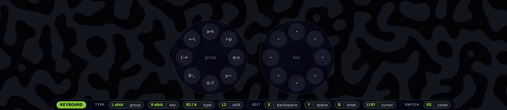

# Joyride

Drive Omarchy with a game controller: move between windows and workspaces, work menus, use the pad as a mouse, and type with a two-thumbstick on-screen keyboard. Xbox, PlayStation, Switch and generic (DirectInput) pads are recognised.




Games keep the pad until you take it. **Hold Guide for about half a second** (on pads with no Guide button, hold **Start + Select**) and Joyride switches on and grabs the pad exclusively, so nothing underneath sees your presses. Hold again to hand it back. A bar along the bottom of the screen shows the current mode and what every button does.

## Modes

Buttons are named by position and shown with your controller's own labels (A/B/X/Y, ✕ ○ □ △, or Switch A/B/X/Y).

| Mode | Controls |
|---|---|
| **Navigate** | D-pad or left stick: focus. L1/R1: previous/next workspace. L2/R2: shrink/grow column. West button: cycle column width. South: Enter. East: Escape. L1+R1+East: close window. Start: Omarchy menu (D-pad then sends arrow keys). North or R3: keyboard. L3: mouse. |
| **Mouse** | Right stick: pointer. Left stick: scroll. South/East/West: left/right/middle click. L3: back to navigate. |
| **Keyboard** | Left stick picks a group of eight, right stick picks a key in it, R2 or South types it. L2: shift. West: backspace. North: space. East: Enter. L1/R1 or D-pad: move the cursor. R3: close. |

On Nintendo pads the confirm and back buttons swap so A confirms, as on the console (`confirm: "auto"`).

## Requirements

- Omarchy with the shell plugin system and Hyprland.
- `python3` and `wtype` (typing and menu keys).
- Read access to `/dev/input/event*` and write access to `/dev/uinput` (mouse mode). The logged-in seat normally has both; otherwise add yourself to the `input` group.

No other packages: the input helper is plain Python.

## Install

```bash
git clone https://github.com/jgarza9788/joyride ~/.config/omarchy/plugins/jgarza.joyride
```

Add the plugin to `~/.config/omarchy/shell.json`, then reload:

```jsonc
{ "plugins": [ { "id": "jgarza.joyride" } ] }
```

```bash
omarchy-shell shell rescanPlugins
```

## Remove

Delete the `{ "id": "jgarza.joyride" }` entry from `shell.json`, run `omarchy-shell shell rescanPlugins`, and delete `~/.config/omarchy/plugins/jgarza.joyride`. Optionally remove `~/.config/jgarza.joyride/`.

## Settings

Put these keys in the plugin's entry in `shell.json`:

```jsonc
{ "id": "jgarza.joyride", "holdMs": 450, "confirm": "auto", "cursorSpeed": 1400 }
```

| Key | Default | |
|---|---|---|
| `holdMs` | 450 | How long to hold Guide (or Start+Select) to switch on/off |
| `confirm` | `auto` | `auto`, `south` or `east`. Auto uses east on Nintendo pads |
| `cursorSpeed` | 1400 | Mouse mode pointer speed (pixels per second at full tilt) |
| `scrollSpeed` | 12 | Mouse mode scroll speed |
| `deadzone` | 0.18 | Stick deadzone in mouse mode |
| `hud` | true | Show the bottom bar and keyboard |
| `startCommand` | `["omarchy-menu"]` | Command run by Start |
| `selectCommand` | `[]` | Command run by Select (for example a launcher) |

## Command line

```bash
omarchy-shell joyride status            # mode and connected pads, as JSON
omarchy-shell joyride toggle
omarchy-shell joyride mode keyboard     # off | nav | mouse | keyboard
omarchy-shell shell toggle jgarza.joyride
```

## Pads that map oddly

Generic pads vary. Run `python3 bin/joyride-input --dump` and press each button to see its raw code, then override in `~/.config/jgarza.joyride/mappings.json`:

```json
{ "0079:0122": { "buttons": { "288": "south" }, "axes": { "2": ["rx", "stick"] } } }
```

Button names: `south east west north l1 r1 l2 r2 select start guide l3 r3`. Axis names: `lx ly rx ry lt rt`, type `stick` or `trigger`.

## Notes

- Xbox, PlayStation and Switch layouts follow the Linux `xpad`, `hid-sony` and `hid-nintendo` drivers and are covered by unit tests. Joyride has been run on a generic DirectInput pad only, so please report anything that maps wrong on yours.
- Joyride runs inside the shell with the same access as any plugin. Its helper only reads input devices and, in mouse mode, creates a virtual mouse.

## Tests

```bash
node tests/model.test.js
python3 -I -B -m unittest discover tests
```

MIT licensed.

## Demo

`demo/` holds everything behind the videos: `virtualpad.py` (a software Xbox pad made with uinput that logs its inputs), `drive.py` (choreographs a run on the real desktop and records it), `music.py` / `music2.py` (two CC0 synthwave tracks), `build.py` (the showcase cut), `build2.py` (the beat-synced trailer) and `controller.py` (a wireframe pad overlay) and `controller2.py` (a glossy one), both lighting up with the logged inputs. Joyride sees the virtual pad exactly like real hardware.
